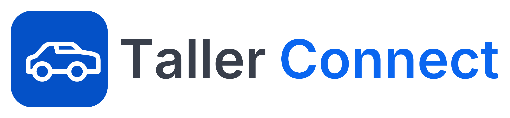

<div align="center">

<picture>
  <source media="(prefers-color-scheme: dark)" srcset="docs/img/logo-oscuro.png">
  
</picture>

### App móvil para clientes del taller

Consulta tus vehículos y sigue el estado de cada reparación desde el móvil.


</div>

---

## Sobre el proyecto

**TallerConnect** es un sistema de gestión para un taller mecánico formado por tres partes que comparten la misma API:

| Parte | Quién la usa | Tecnología |
| --- | --- | --- |
| **App móvil** (este repositorio) | Clientes del taller | Android · Kotlin · Jetpack Compose |
| Aplicación de escritorio | Administrador del taller | JavaFX |
| API REST | Ambos clientes | PHP · Apache · MySQL/MariaDB |

Esta app es la del **cliente**. Desde ella puede registrarse, añadir sus vehículos, ver en qué punto está la reparación de cada uno, cuánto tiempo queda y consultar el historial de reparaciones anteriores.

> Proyecto Intermodular de 2.º de Desarrollo de Aplicaciones Multiplataforma (DAM).

## Funcionalidades

- Registro e inicio de sesión del cliente.
- Cambio de contraseña obligatorio en el primer acceso cuando el taller crea la cuenta con una contraseña temporal.
- Listado de vehículos con su estado actual.
- Alta de un nuevo vehículo.
- Estado de la reparación: progreso, tiempo restante estimado, hora de entrega e incidencias completadas.
- Historial de reparaciones de cada vehículo.
- Menú de navegación inferior: **Vehículos · Reparación · Historial · Cuenta**.

## Pantallas

| Pantalla | Casos de uso | Pestaña inferior |
| --- | --- | --- |
| Inicio de sesión | CU-12 | — |
| Crear cuenta | CU-11 | — |
| Mis vehículos | CU-13, CU-14 | Vehículos |
| Añadir vehículo | CU-13 | — |
| Estado de la reparación | CU-14 | Reparación |
| Historial | CU-15 | Historial |
| Cuenta | — | Cuenta |
| Cambiar contraseña | CU-19 | — |

<!--
Cuando tengas capturas, guárdalas en docs/img/ y descomenta esto:

| Inicio de sesión | Mis vehículos | Estado de la reparación |
| :---: | :---: | :---: |
|  |  |  |
-->

## Estado del proyecto

- [x] Diseño de pantallas y prototipo navegable
- [x] Interfaz de las pantallas en Jetpack Compose
- [x] Navegación entre pantallas
- [ ] Arquitectura MVVM (ViewModel y estados de pantalla)
- [ ] Conexión con la API REST
- [ ] Autenticación y almacenamiento seguro de la sesión
- [ ] Pruebas
- [ ] Manual de usuario

Ahora mismo la app contiene **solo la parte visual**: los botones y campos están preparados para engancharles la lógica, pero todavía no hay datos reales ni conexión con el servidor.

## Estructura del código

```
app/src/main/java/com/example/tallerconnect/
├── MainActivity.kt
└── ui/
    ├── components/    Componentes reutilizables (botones, campos, barra superior e inferior…)
    ├── model/         Modelos de datos que se pintan en pantalla
    ├── navigation/    Rutas y navegación entre pantallas
    ├── screens/       Una pantalla por archivo
    └── theme/         Colores y tema de la app
```

## Cómo ejecutarlo

1. Clona el repositorio:
   ```bash
   git clone https://github.com/TallerConnect/TallerConnectAndroid.git
   ```
2. Ábrelo con **Android Studio** (carpeta raíz del proyecto) y espera a que termine la sincronización de Gradle.
3. Elige un emulador o un móvil con Android 7.0 (API 24) o superior.
4. Pulsa **Run ▶**.

Cada pantalla tiene su `@Preview`, así que también puedes verlas sin ejecutar la app, desde el panel *Split* del editor.

## Más sobre TallerConnect

El resto del proyecto (documentación, API y aplicación de escritorio) irá en la organización [**TallerConnect**](https://github.com/TallerConnect), junto a esta app móvil.

## Autores

- **Eva Gallardo Romero** · [@evagr11](https://github.com/evagr11)
- **Carlos Valades Fernandez**

---

<div align="center">
<sub>Proyecto académico · DAM · 2026</sub>
</div>
